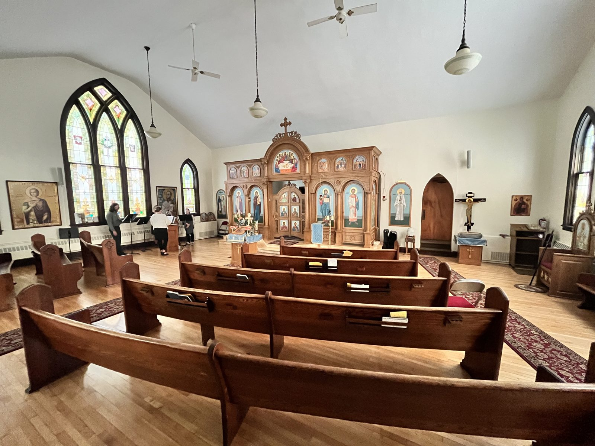
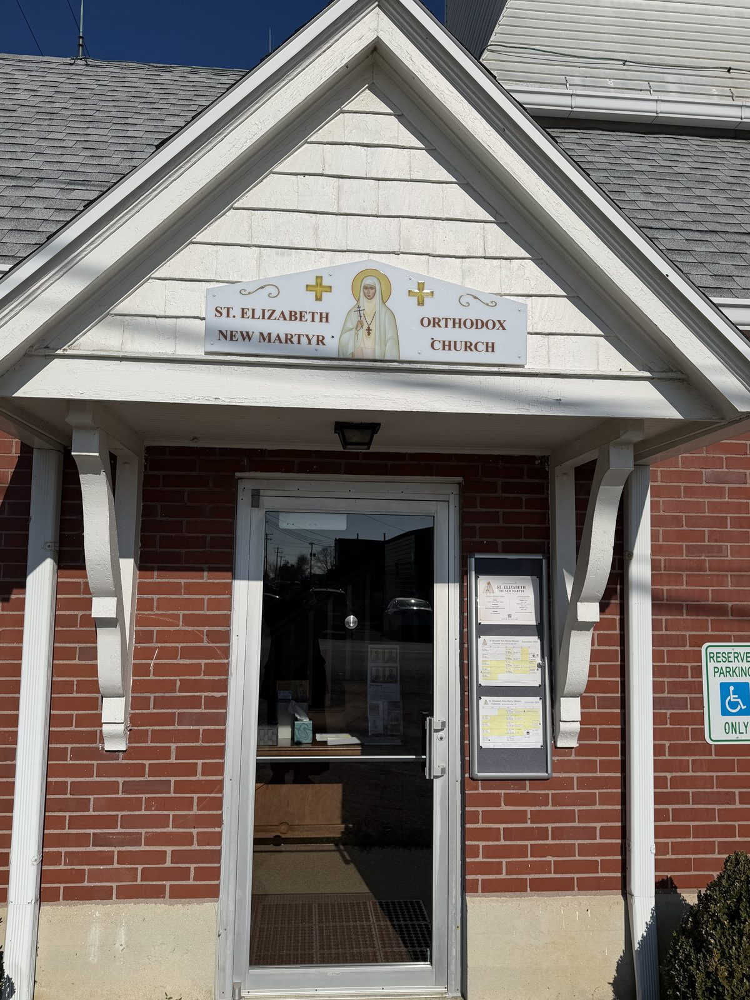
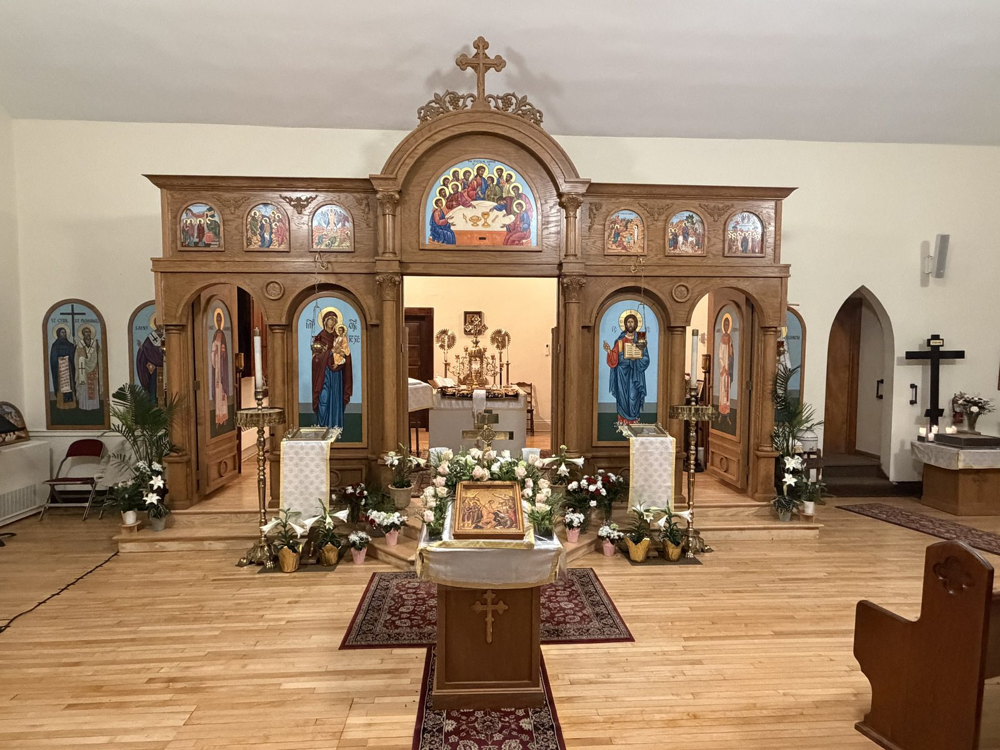

## When to come

The Divine Liturgy begins at **9:30 AM on Sundays** and lasts about 90 minutes. Short morning prayers called the Hours start at 9:10. Arriving a few minutes early gives you time to look around. If you are late, simply come in quietly; many people do.

If you would like a gentler first step, try **Great Vespers on Saturday at 4:00 PM**. It is shorter and quieter, and a lovely introduction to Orthodox prayer.

## Where to park

Visitors and anyone who needs a close space can park in our lot. On Sunday mornings, members who are able park at the Glass City Boardwalk Event Center down the street to leave room for you.

## What to wear

Come as you are. Most people dress modestly, the way you would for a visit somewhere you respect. Some women cover their heads; it is not expected of visitors.

## What you'll see

## During the service

Most of the service is sung, in English. Orthodox Christians traditionally stand to pray, but there are pews, and you are welcome to sit whenever you need to. You may see people make the Sign of the Cross, bow, light candles and kiss icons. Join in as you feel comfortable, or simply watch and pray. No one will single you out.

**Children** are welcome in the service. A little noise is part of a living church.

## Communion and the blessed bread

Holy Communion is received by Orthodox Christians who have prepared for it. At the end of the Liturgy, everyone, including visitors, is welcome to come forward, receive a piece of blessed bread and greet Fr. Arkady.

## After the service

Please stay for **coffee hour**. It is the easiest place to meet people and ask questions. Tell us it's your first visit; we'd love to welcome you.

[Watch a six-minute tour of an Orthodox church](https://www.ancientfaith.com/podcasts/bethebee/six_minute_church_tour) before you come.
