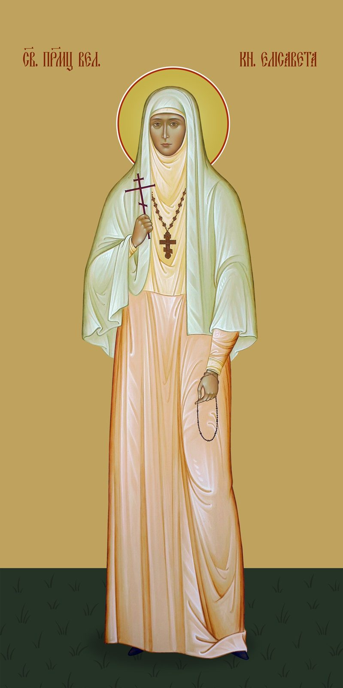

## Our bishop

**His Eminence Archbishop Alexander (Golitzin)** is the shepherd and overseer of our parish. He was elected Bishop of Toledo and the Bulgarian Diocese in October 2011, was consecrated in 2012 at St. George, our mother parish, and serves on the Holy Synod of the Orthodox Church in America. [Learn about the diocese](https://www.bdoca.org).

## Our pastor

**Fr. Arkady (Migunov)** was born in 1973 in Tver, Russia. He earned a degree in mechanical engineering in 1996 and a master's degree from the Moscow seminary at the Trinity-St. Sergius Lavra. He was tonsured a monk in 1999 and ordained to the priesthood soon after.

In 2006 Fr. Arkady came to the United States as a missionary, and for more than 16 years served missions in Florida, especially Annunciation Mission in Jacksonville. In September 2023 Archbishop Alexander assigned him to lead our parish.

## Our patron

<figure class="patron-icon"><figcaption>St. Elizabeth the New Martyr</figcaption></figure>

**St. Elizabeth the New Martyr** was born a German princess and raised Lutheran. She married Grand Duke Sergei of Russia and freely embraced the Orthodox faith. After her husband was assassinated in 1905, she forgave his killer, gave away her possessions and founded a convent in Moscow to care for the poor and sick. She was martyred in 1918. We celebrate her feast on July 18.

Her journey, from a Protestant upbringing to Orthodoxy and a life poured out in love, is close to the hearts of many who find their way to our parish.

## Our diocese

We belong to the Bulgarian Diocese of the Orthodox Church in America, founded by Bulgarian and Macedonian immigrant communities and part of the OCA since 1976.
