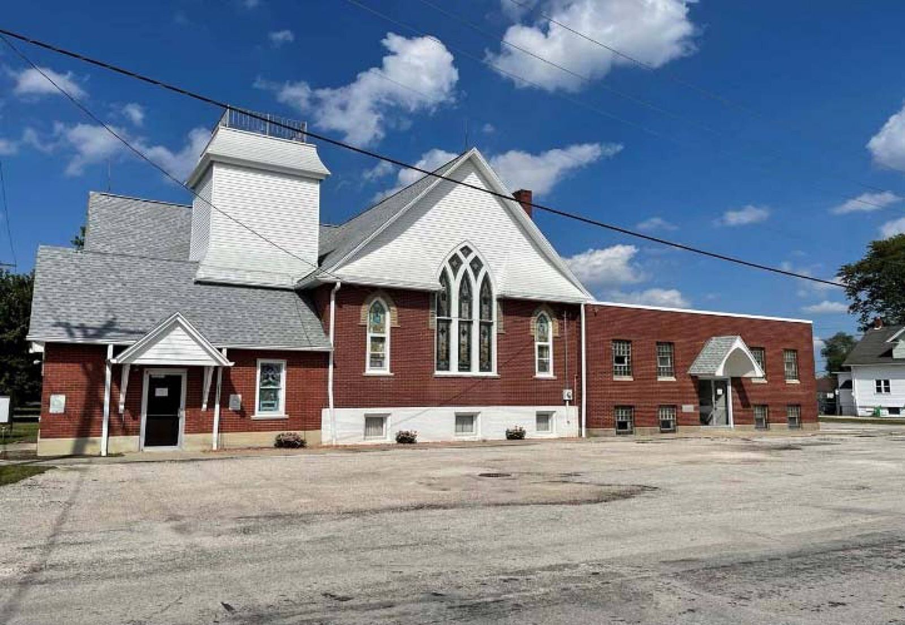

For more than a year the St. Elizabeth mission had been looking for a permanent home. It found one in the former Moline United Methodist Church at 28010 East Broadway, a red-brick church that had served its neighbors since 1883.

On Saturday, April 27, 2024, parishioners gathered to clean the building and prepare it for worship. The next morning, Palm Sunday, April 28, the first Divine Liturgy was served in the new church. All of our services have been held there since.

[Read the full history of our parish](/about/history/)
